# Personal Agent 综述研究笔记

- 原文标题：这是一篇把“Personal Agent”讲明白的科普级综述！
- 原文链接：https://mp.weixin.qq.com/s/j6swcZFbBQuls7Def4HR-Q
- 作者：郑天（阿里云 Agent 技术专家）；发布公众号：Datawhale（文章注明已收录于 Alibaba Cloud AI Agent Handbook）
- 发布日期：2026-10-18
- 整理日期：2026-10-19

> 本文为研究笔记式转述，版权归原作者。

原文图片中的信息已转写为表格、mermaid 图、公式或文字要点，本笔记不包含任何图片。章节编号沿用原文：原文没有第三节，从第二节直接跳到第四节。原文里纯展示性的产品截图和宣传图，只用一两句话说明内容。

---

## 0. 引子：2026 年 9 月的集中发布

原文开头列出了 2026 年下半年的发布时间：

| 产品 | 厂商 | 关键时间 |
|---|---|---|
| Grok Bot | xAI/Grok | 8-11 上线；8-21、8-26 两次扩大个人与团队资格；9-03 开放企业；9-28 推出 Team Bots |
| Muse | Meta | 9-08 发布 |
| Manus 2.0 与 Cue | Manus | 9-28 发布 |
| dots | OpenAI | 9-29 发布（DevDay） |

作者的判断是：这么密集的发布说明，"模型 + 云端执行环境 + 应用连接 + 长期任务管理"正在被打包成面向终端用户的完整产品。这类产品有几个共同点：

- 用户离开页面后，任务仍然继续推进。
- 连接邮箱、日历、浏览器，部分产品接入支付工具，甚至给 Agent 配了独立手机号。
- 启动方式有三种：定时运行、由邮件或外部事件触发、跨多次任务保留项目知识。
- 用户交办任务的主界面不再只是一段即时对话，还包括任务列表、审批页、计划安排、记忆管理和执行记录。

文章要讨论三件事：为什么 Personal Agent 成为新的竞争点，它依赖哪些底层技术，以及国内厂商可能的跟进方向。

> 题图（图 1）是一款 Personal Agent 的客户端截图。手机端和桌面端同时显示，左栏是多个各有角色和形象的 Agent（工作助理、邮件助理、日常助手、"Senior Designer"、简历、会议纪要、东京旅行等对话）。示例对话里，用户上传一张咖啡店网站草图，Agent 给出暖色和深色两个设计方向，再生成手机版并询问是否导出到 Figma。

---

## 一、从聊天助手、早期 Manus 到 OpenClaw：这一轮新在哪里

### 1.1 核心论点

作者强调，调用工具、后台运行、保存记忆这些能力都不是这一轮才有的。早期 Manus 已经能在云端用浏览器、文件和代码工具完成目标；OpenClaw 也已经有长期记忆、定时任务和周期唤醒。**这一轮的新意在产品组织方式**：厂商开始以"一个具体用户"为中心，把下面几样东西整合进同一个产品：

- 长期运行环境（一台真正的电脑）
- 个人身份
- 触发条件
- 审批
- 记忆管理

### 1.2 四种形态对比（图 2，原文表格转写）

| 事项 | 普通聊天助手（Chatbot） | Manus 1.0 | OpenClaw | Personal Agent |
|---|---|---|---|---|
| 主要组织单位 | 当前对话 | 一项明确任务 | 用户自己配置的运行时与会话 | 同一用户长期使用的产品 |
| 主要能力 | 回答、建议、生成草稿 | 在云端执行多步骤任务并交付结果 | 自托管、接入工具、记忆与计划任务 | 把执行环境、个人数据、触发、审批和记忆管理整合在一起 |
| 启动方式 | 用户发起对话 | 用户新建任务 | 用户消息、heartbeat、cron、Webhook 等 | 用户发起、定时条件、邮件或其他外部事件（因产品而异） |
| 身份与个人数据 | 主要用当前账号和会话信息 | 以当前任务所需的授权为主 | 由用户配置渠道、账号和本地文件 | 部分产品提供独立身份，或长期连接个人应用与数据 |

各形态的要点：

- **聊天助手**：以当前会话为中心。即使能调用工具，任务也由当前对话启动，之后是否继续、何时再跑，仍由用户决定。
- **早期 Manus**：本质是云端任务执行器，目标是交付一份报告或网页。后来补上的 Sandbox、Cloud Computer、Project、Schedules，分别对应隔离环境、常驻机器、项目知识和定时执行，但产品主线仍是"完成用户交办的一项任务"。
- **OpenClaw**：一个可以自己部署和配置的个人 Agent 运行时。有长期记忆，默认大约每 30 分钟一次 heartbeat，任务调度器的状态落盘在网关里。用户可以部署在个人电脑或服务器上，接入消息渠道，配置 cron、Webhook、工具和权限。代价是运行环境、配置和安全责任更多落在用户自己身上。
- **2026 年的 Personal Agent**：把上面这些能力做成面向普通用户的完整产品。有的给 Agent 配独立邮箱、电话或钱包；有的给每个用户一台隔离的云电脑，并接入邮箱、日历、浏览器和支付；再配上任务列表、审批页、记忆管理、计划安排和执行记录。目标是让同一个 Agent 在多次任务之间保留必要信息，在时间到点或外部事件到来时继续工作，同时让用户能查看和撤销权限。各产品对这些能力的支持程度不一。

### 1.3 Personal Agent 的四个组成部分（图 3）

原图的主线是"运行智能 → 持续执行 → 调用服务 → 获得社会授权"，四部分合起来，才构成一个"能持续办事"的 Personal Agent。

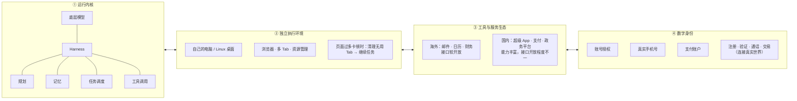

文字补充：

1. **运行内核**：底层模型，加上围绕模型搭建的 Harness，负责规划、记忆、任务调度和工具调用。
2. **独立执行环境**：能持续工作的 Agent 通常需要一台属于自己的电脑（例如独立的 Linux 桌面），能像人一样操作浏览器、管理多个 Tab、处理资源占用。作者实测发现，页面太多导致系统卡顿时，Agent 需要主动关掉无用的 Tab 再继续。
3. **工具与服务生态**：海外的邮件、日历、财务软件接口相对开放；国内的能力集中在超级 App 和政务平台里，信息流、支付、借贷、政务服务样样都有，但对外开放的接口有限。
4. **数字身份**：Agent 要从"操作软件"走到"代替个人办事"，需要现实社会能识别和授权的账号、支付工具和通信号码。网络电话只能打电话；真实手机号和支付账户则意味着可以注册服务、验证身份、拨打电话乃至完成交易。

---

## 二、十款产品的设计路线观察：海外高度同质化，国内尚未破局

### 2.1 总表（图 4，原文表格转写）

| 产品 | 发布节点 | 核心形态 | 身份与权限 | 持续 / 记忆 | 执行与协同 |
|---|---|---|---|---|---|
| Cue | 2026-09-28 | 独立的 Personal Agent 应用 | 邮箱、电话、钱包、电脑；支付受控 | 事件自动化；长期记忆的公开说明较简略 | 以云端为主，可控制本机；多 Agent 群聊 |
| Wajo Fo | 2026-08-25 | 行动型 Agent + 人类兜底 | 独立邮箱、电话、语音、支付工具 | 长期主动，并随反馈调整 | 云端执行，遇到瓶颈可转给人类助理 |
| Instinct | 2026 | 以电话和消息为入口的轻量工作台 | 独立邮箱，强调 Agent 间的可信网络 | 接入邮件、消息与设备信号，主动跟进 | 云端，侧重跨主体协调 |
| dots | 2026-09-29 | GPT-6 Astra 驱动的常驻 Agent | 暂无独立邮箱；对外动作有 Auto-review | 定时、事件、主动研究；区分任务记忆与持久记忆 | 每用户隔离的云工作区，可选本机；先提供一个主 dot |
| Meta Muse | 2026-09-08 | 持续存在的云端计算机 Agent | 部分身份能力，独立邮箱是后续扩展 | 持续的个体上下文，推进长期目标 | 每用户独立 Linux 虚拟机（VM）；并行请求与 side chats |
| Gemini Spark（原文写作 "Gemeni"） | 2026-05-19 | Gemini 内的全天候 Agent | 借用 Google 账户授权 | 时间、Gmail、主题事件三类调度 | Google Cloud 专用 VM，可遥控 Mac |
| Grok Bot | 2026-08-11 | 多 Bot 常驻团队 | 同一用户的 Bot 共用账户和云电脑 | 角色记忆、群聊共享、定时计划与事件 | 共享云电脑，个人 / 团队 Bot 分工 |
| Manus | 2025-03 起 | 通用任务 Agent 的演进平台 | 主要借用用户授权，不以独立身份为核心 | 定时任务保留上下文，Project 自更新 | 任务 Sandbox、Cloud Computer（云电脑）、Wide Research 子 Agent |
| OpenClaw | 2026-01 | 开源、可自托管的个人 Agent | 借用渠道身份；权限与审批可配置 | Markdown、SQLite 索引、heartbeat、cron、Webhook | 个人电脑或服务器；主会话与子会话 |
| Today.ai | 2026 | 记忆可管理的日常助理 | 部分身份化，对外动作需确认 | 早间简报、晚间收尾；记忆可查看、编辑、删除 | 常驻云端电脑，单 Agent |

作者的个人体验：

- **Grok Bot** 是目前能力最完整的一款，确实能长时间 24 小时工作。作者常让它整理推文和热点，效果很好；配给它的云电脑配置很高，相应地价格也偏高。
- **dots** 的优势是和 Codex 集成，而且目前 Pro 用户不限量。

作者把产品按设计路线分为四类，下面逐类整理。

### 2.2 路线 A：给 Agent 独立的邮箱、电话和支付能力（Cue / Fo）

#### Cue（Manus 出品）

- 2026-09-28 随 Manus 2.0 公布的独立应用，给每个 Agent 配齐邮箱、电话、钱包和电脑。
- 能收发邮件和消息，在用户控制的权限内付款，用户离开后继续工作。
- 官方示例：多个 Agent 在群聊里调研纽约的发布会场地、筛选候选并制作演示稿；线下扫商家二维码可以生成该商家的专属 Agent，用来订座、代点餐或排队。官网展示了 Trip.com、Oura、Gmail、MyFitnessPal 等连接器。早期访问免费，需要邀请码。
- 图 5：左边是扫店门口二维码的取景界面（提示要扫全店通用码，而不是桌码）；右边是扫码生成的"Cheesy Pizza Assistant"，可以点披萨或订座，用户订了当晚 6:30 的桌位后收到确认。
- 图 6：与题图（图 1）是同一张多 Agent 客户端截图。
- 图 7："Trip Planner"群聊。用户请求规划一次轻松的 3 天京都行，行程助理、打包助理、预订助理分工协作：行程助理产出逐日安排（东山、岚山、市区）的 Markdown 文件并 @ 预订助理；打包助理产出分为必带和可选的打包清单；预订助理整理好交通票和景点通票，承诺付款前先把时间、价格和退改政策发给用户确认。

用户反馈几乎都指向落地摩擦，而不是任务成功率：

- **电话收费**：有用户发现电话功能每月 9.9 美元；首月免费，之后起价约 20 美元。单论价格，Muse 更划算。
- **电话能力像是后加的**：部分热门国家收不到短信；号码所属国家和当前代理 IP 绑定，换区要先换 VPN。官方也说明电话只在部分地区开放，部分地区仅支持语音。
- **沙箱 IP**：重启容器会换一个"住宅"IP，有人连试三次分别落在巴基斯坦、埃及、越南，另一些人是菲律宾、哥伦比亚，几乎碰不到主要西方国家。
- **产品形态**：有用户认为 Cue 基本是把原来 Manus Agent 面板里的能力拆成了独立 App，接下来要看 token 和额度够不够用。

#### Fo（Wajo 出品，前 DeepMind 员工创业）

- 2026-08-25 发布，定位是"把事做完"的行动型 Agent。有自己的电话、邮箱、语音，以及一次性支付卡（商家和 Fo 都看不到用户的真实卡号）。卡住时转给人工助手。
- 9-28 对公众开放，分三档：免费的 Fo Mini（有每日任务上限）、邀请制的无限量 OG、按需报价的 Pro。
- 官网数据：内部 104 项真实杂务的完成率约 71%，信任率 94%。
- 创始人 Shivani Poddar 有 CMU、Meta、Google DeepMind、Google Labs 的履历，但 Fo 不是 Google 产品。
- 图 8：发布视频截图，标语是 "Agent Built To Get Sh*t Done"，配有 Wajo 标志和一个白色方块吉祥物。
- 图 9：多语言能力演示。Fo 给一家墨西哥餐馆 "El Taco Loco" 打电话，用西班牙语请对方转告厨房，界面同时显示英文翻译，并标出 "Multi Language" 能力和 0.17s 的响应时延。
- 图 10：真人助理参与任务的演示截图，标签为 "Real human's to do tasks"，画面中一位真人正在打电话。

**代表性设计：人机之间的正式交接。** 自动化遇到瓶颈时，任务转给训练过的人类执行助理，由他们处理机器做不了的现实环节（主要是电话），再把结果写回任务流程。换句话说，Fo 可以"雇人"外包部分环节，并在这个过程中向人学习。

使用案例：

- 一位用户用了 8 天：预约医生时对方一直不接，Fo 循环重拨、留言，第三次打通并订上。查延误包裹时，它从邮箱里找到运单号，用自己的邮箱联系商家并抄送用户，问清用户要换货还是退款后，让商家改发 FedEx 隔夜件。
- Costco 拦截了 Agent 下单。Fo 没有硬去买更贵的替代品，而是先比价确认 Costco 仍然最便宜，建好购物车后把付款交还给用户。
- 官方列举的早期任务：多国多语言点外卖并付款、寄生日礼物和医院鲜花、问咖啡馆排位、订理发和按摩、值机、按预算比价酒店、找当天能上门的持证维修工、续费域名。

反馈：

- 优点：电话重试和"卡住就转人"被认为比同类产品实用。
- 缺点：保险报价仍是一问一答地填表，不会先一次性把所需字段要齐；通过 iMessage 收身份证、生日等敏感信息时，没有"已存入保险库、仅本次使用"之类的确认，信任感不足。

### 2.3 路线 B：把 Agent 接入现有应用生态（dots / Muse / Spark / Today）

#### dots（OpenAI）

- 2026-09-29 在 DevDay 发布，基于 GPT-6 Astra，有自己的云电脑，通过插件生态连接 4000 多个应用。
- 首发只提供一个主 dot（primary dot）。面向组织的专用 dots（specialist dots）还在重点企业试点阶段，与 Microsoft Agent 365 的整合属于合作方向。
- **上下文分三层**：当前任务上下文、相关的 ChatGPT 记忆、dot 自己的持久上下文。最后一层不是全部对话的逐字副本。
- **执行与安全**：每用户隔离的 Linux/Chrome 云工作区负责执行；密码通过安全登录流程直接进入浏览器，不进入模型上下文；一个独立的 Auto-review 环节检查可能影响外部世界的动作是否在授权范围内。
- 官方的工程场景：持续整理反复出现的用户反馈，做出经过测试的修复 PR，附上视频后等待人工审核。

dots 的架构（图 11，官方示意图转写）：

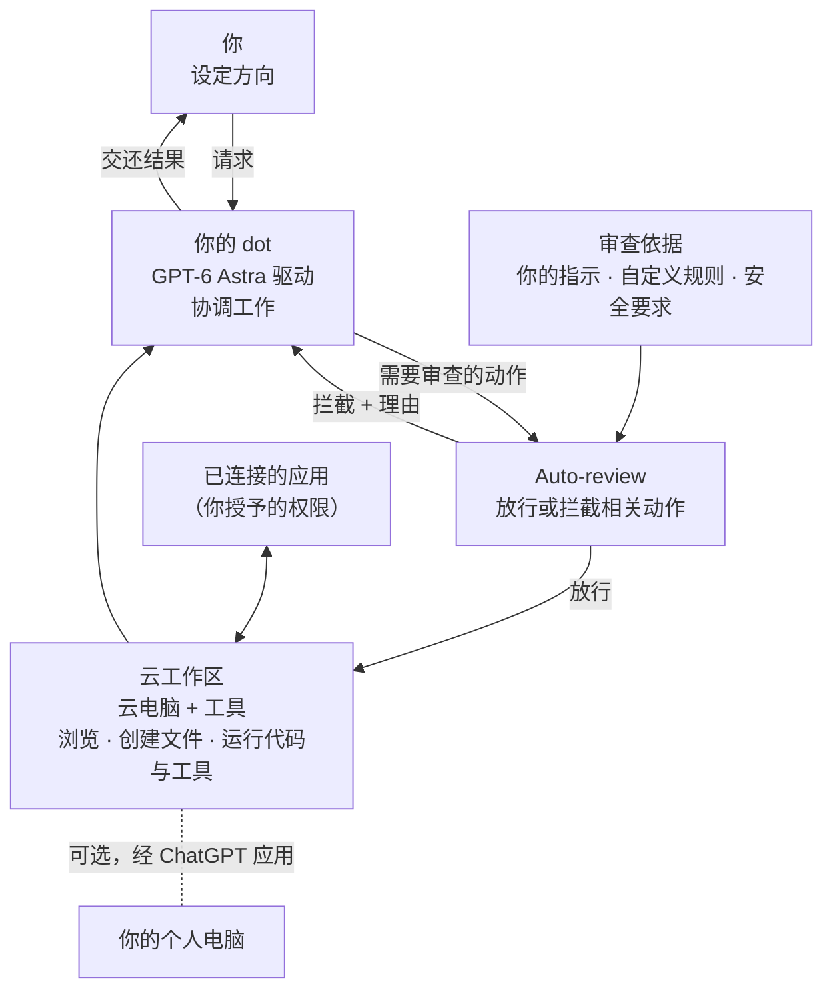

图 12 是作者自己使用 dots 的截图：左边是和 Agent（作者给它起名"胖胖"）的对话和一通 3 分 28 秒的通话记录，Agent 在自己的云浏览器里截取了 Cue 官网（"你的专属 Agent，随时 Cue"，展示专属电话号码）；右边是"胖胖的电脑"实时画面，正在浏览 dots 官网，底部提示"胖胖拥有控制权"，并有一个"接管"按钮。作者说自己经常长时间开着电话，直接用语音指挥 dots 干活，确实很有"人"的感觉。

使用案例：

- 一位早期测试者的 dot 发现用户忘了给某刊物开发票，于是从邮件线程里抽出信息生成 PDF，用户批准后发出。
- 有评测认为它写研究简报、做小网站和测验页的效果不错。
- The Neuron 的一日体验：起名、连接应用都很顺；第二天它主动打电话过来继续聊，比预期自然。

社区反馈两极分化：

- 正面：上手快，个性可调，能从已连接的应用里主动找事做，iOS 上的消息式界面受到好评。
- 负面，集中在"还没准备好"：
  - 主动性基本只是定时任务，缺乏常识，用户还得去撤销它的操作；
  - 与 Codex 的远程或云端连接不稳定，会空转烧 token；
  - 语音比普通的 GPT Live 差，接通慢；
  - 不能修改自己的 AGENTS.md，作为长期日常助手缺少控制权；
  - 有评测者认为暂时不值得从 Claude 浏览器、Grok Bot 或 Hermes 换过来：电脑操作慢，测试中电话没打通，出图慢，简单任务也要几分钟；还有人反馈 Windows 本机的 computer use 暂不可用。

#### Muse（Meta）

- 2026-09-08 正式发布。每个用户有一台持续存在的云端计算机和浏览器，可以从 iOS、Android、muse.ai、WhatsApp 使用，关掉 App 后工作继续。
- **交互**：一个持续的主对话可以并行处理多个请求、允许打断，复杂话题可以另开侧边对话（side chats）。用户可以给 Agent 起名、设置形象。交付物可以是文件、网页或交互内容（artifacts）。
- **支付**：美国用户可以连接 Stripe Link，交易总额仍需人确认，Agent 看不到底层的真实支付信息；其他场景使用与已批准交易绑定的一次性虚拟卡。
- **9 月底公布的扩展**：未来几个月接入 AI 眼镜；Muse for Mac 已能操作电脑；独立电子邮件地址。小企业场景可连接 Asana、Canva、Notion、QuickBooks、Shopify、Slack、Stripe。
- 注意区分：这里的 Muse 指个人 AI Agent，不是底层的模型家族 Muse Spark、Muse Image/Video。

图片说明：

- 图 13：Muse 在 muse.ai 的界面，嵌在云电脑窗口里。Agent 头像是毛绒小人，状态显示"已连接"。开场白是"我是你的专属助手，不只是普通的聊天机器人"，并询问用户的名字。底部提示"您拥有控制权 / 交还控制权"。
- 图 14：手机端购物对话。用户要一款预算 500 元的降噪耳机，Agent 先让用户在"真无线入耳式 / 头戴式"之间选一个，然后去京东和天猫搜索。结论是两家在它的浏览器里都要求先登录才能看商品，没法继续，于是给用户几个继续的方式。这说明了国内平台对 GUI Agent 的登录壁垒。
- 图 15：支付审批卡片。"Checkout · Veda wants to place an order at ncvss.com"，提醒用户在商家网站上仔细核对订单详情和条款后再批准。卡片显示商品（一款折叠婴儿车 80 美元）、支付方式（尾号 1234 的信用卡，经 Pay with Link）、预估总额 80 美元，以及 Deny / Allow 两个按钮。

**技术重点：Secure VM。** 文字要点如下：

- 每个用户一台独立的 Linux 虚拟机。Agent 运行在 VM 里的 systemd-nspawn 容器中，即使拿到容器的 root 权限，也不能直接控制宿主机。
- 凭证、审批和安全服务都在容器外面。authd 管理凭证，模型主要接触的是替代令牌（surrogate token）。
- Sentinel 在发起网络请求时检查连接器操作和访问目标。操作获批后，系统才在网络边界处换上真实凭证。
- eBPF 用于流量控制和数据污染追踪。
- 浏览器由独立的 broker 进程管理。子 Agent 主要通过无障碍树（accessibility tree）读取界面，以减少任意执行网页 JavaScript 的机会。

Secure VM 架构（图 16，官方架构图转写）：

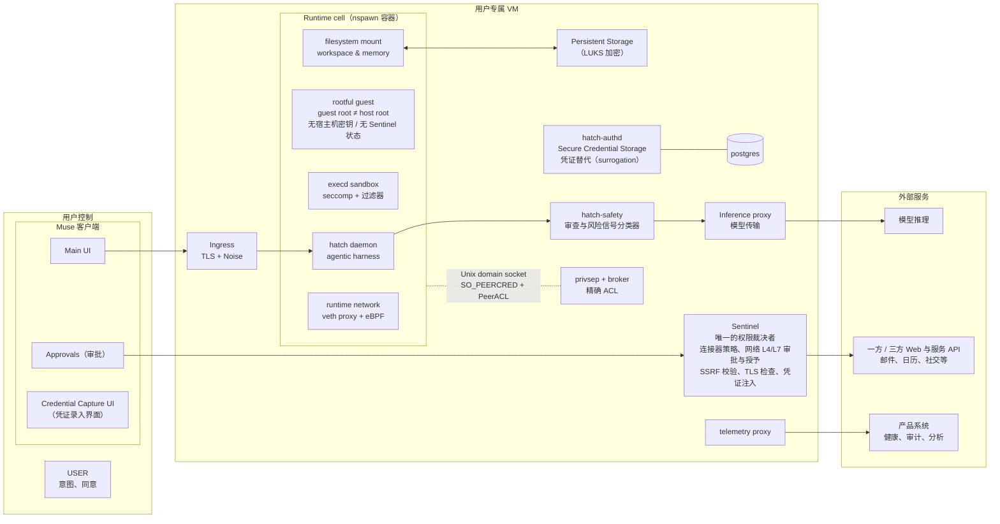

使用案例：

- 《纽约时报》记者用了两周：Muse 替他打给牙科保险公司，报会员号、回答安全问题、等待转接；连上信用卡后把消费记录导入 Google Sheets，标出两个重复订阅并取消；发邮件要回过期报纸试用的 44.99 美元退款；订晚餐、做播客。作者称这是他用过最有用的 AI 应用。
- TechRadar：点早餐、填表、发邮件，比"虚拟浏览器"类产品顺手。
- 有分析师让它根据 Airbnb 历史和 Instagram 收藏找住处，它找到一间能直接向房东预订、比平台便宜约 60% 的农舍。
- 普通用户案例：看到广告后下载、给父亲买鞋，设置步骤很少。

负面反馈几乎都是权限和平台对抗：

- WIRED 和隐私组织批评它默认把对话用于模型训练，记忆没有关闭开关，只能在聊天里请它清除。有专栏作者拒绝了 Messages 权限，仍被同步了超过 18.7 万条 iMessage，官方解释对不上。
- Amazon 以未授权访问和隐私为由屏蔽 Muse 代购；有报道称内部测试曾暴露用户的 iCloud 照片。
- 体验上：复杂流程能跑一段，但一到更深的推理就出错；高峰时搜索不稳定。"方便"和"把生活交给 Meta"的不适感经常被一起提到。

作者的观察：Muse 在海外走红，靠的是三点：更有亲和力的毛绒形象（作者设想国内可以和泡泡玛特这类潮玩联名）；会回复消息、点赞，很有"人"的感觉；在 Agent 任务上模型能力不错（作者称在 AA 榜上排第二）。图 17 是两个米白色毛绒小人手拉手的形象图，即 Muse 的 IP 形象。

#### Gemini Spark（Google）

- 优势来自 Google 生态。2026-05-19 在 I/O 大会公布，运行在 Gemini 产品里，由 Gemini 模型加 Antigravity 运行框架（harness）驱动，连接 Workspace，在 Google Cloud 的专用 VM 中执行。
- **调度**：支持时间、Gmail 条件、主题事件三类触发；最多 50 个活动计划，同时运行的任务最多 15 个。
- **迭代**：6 月加入 Mac 客户端、Keep、Tasks 和自定义 MCP；7 月可在用户许可下利用 Chrome 的登录状态和已保存密码处理网页事务，并扩展到 160 多个国家；9 月接入 Google Photos。
- **安全研究**：Google DeepMind 的 AI Control Roadmap 中的异步监控研究为实时监控提供支撑，官方称分析过百万量级的编码 Agent 任务。
- **限制**：用户需年满 18 岁；高流量时可能延迟；使用 Chrome 本地路径时，设备和 Chrome 都得保持开启。官方仍称它为早期实验功能，并提示存在提示注入、错误操作和个人信息外泄的风险。

图片说明：

- 图 18：宣传拼图。用户请求"在 Skytravel 上找 8 月 20–24 日湾区到西雅图最便宜的直飞航班，登录账号填好信息，准备好下单时通知我"。中间是 Agent 的思考轨迹（发起对旅行工具的检查、并行调用航班搜索、调用 Google Flights、Google Profile、Google Workspace Search）。右侧有"正在输入目的地机场"、"Take over task"（接管任务）按钮和"Task done"状态。
- 图 19：Spark 的任务列表界面（桌面 + 手机）。最近任务包括"晨间优先事项摘要"（根据隔夜邮件、文档和聊天生成）、"团队团建预算方案"（标记 Needs input，等用户批准已起草的邮件）、"纽约夏季旅行规划"（寻找与家人时间匹配的替代航班）。下方是推荐模板：清理收件箱、主题深度研究、定制新闻摘要。

#### Today.ai（国内）

- 作者称它是国内最早发布 Personal Agent 的公司。没有公开同等详细的架构，但**把记忆管理放进了用户界面**：个人记忆包括人物、项目和偏好，用户可以查看、编辑、删除。
- 提供早间简报和晚间收尾，连接邮件、日历、笔记和任务，对外动作需要用户确认。官方的客户改期示例里，Agent 读取邮件、检索项目日期，然后准备回复和新的里程碑。
- 交互简单，有主动推送能力。比如知道用户从事计算机行业，就会主动查找并推送相关信息。
- 争议：要求大量权限，登录后会扫描本地磁盘，个性化程度很高，但代价是大量使用用户数据，受到部分海外用户批评。另外可能出于成本考虑，它的"云电脑"其实只是一个沙箱，并不是海外几款产品那样的真实云电脑。
- 图 20：Today 的桌面界面，Agent 名叫 Momo。左边是对话，Agent 主动汇总当天国内几家大厂的模型发布新闻（建议收进用户的 AIGC Weekly），还提醒用户的开源仓库收到两条社区 PR 和一条 issue，等待处理。右边是"今天 / 任务 / 记忆 / Momo"标签页：费用核对后记入账本、某服务 9 月 28 日关停只剩 6 天保存数据（含倒计时和"制定保存计划"按钮）、按日程提醒下午的训练、AIGC Weekly 素材已就绪（播客与技术文章列表）、晚间简报等卡片。

### 2.4 路线 C：多个 Agent 按角色协作（Grok Bot / Manus）

#### Grok Bot

- 2026-08-11 发布。一组 Bot 共享一台云电脑，用户合上笔记本后仍能工作。Bot 之间可以跨应用执行、相互传递上下文、在群聊里分工。覆盖 macOS、Windows、Linux、iOS、Android。
- 主界面是 Bot 名单，显示谁在做什么、哪里需要用户判断。
- **skill 与 routine 的分工**：skill 描述"怎么做"，routine 描述"什么时候做"。Teach a task（示范任务）可以录制最长 10 分钟的可见电脑操作，自动生成 skill 草稿；每个 Bot 最多 50 个 routines。
- **工程案例中的两层分工**：外层 Bot 按 iOS、桌面、Android、基础设施划分角色，内层再调度 Cursor 的云端 Agent；Bot 读取任务记录、截图和 PR 证据，发现异常就追问或中断。
- **Team Bots**（9-28 公测）：共享文件、工具、技能和团队知识，同时保留每个用户的私有对话。
- **官方采购案例**：Agent 整理了约 125 家供应商；其中一项发现识别出 43 个连续 90 天未使用的付费席位；一笔订单从 14,629 美元降到 6,143 美元。
- **安全边界**：多个 Bot 并不等于多个安全域。同一用户的 Bot 共用文件、浏览器 session 和应用登录。每个 Bot 有自己的屏幕，但 Bot 之间没有安全隔离；删除一个 Bot，也不一定会清理共享电脑里的文件和会话。

Grok Bot 用于客服自动化的三阶段（图 21 转写）：

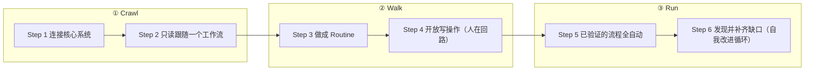

每个阶段都包含前一阶段的全部步骤，依次是：Crawl 只做 1–2 步，Walk 增加 3–4 步，Run 增加 5–6 步。

其余图片说明：

- 图 22："Haggle Bot"（砍价 Bot）分析一份合同续约提案。提案总额 310,560 美元，9 月 12 日到期。其中 207,000 美元是 750 个会议席位（每席年价 276 美元），另外 103,560 美元是附加项（6 个 Webinar Pro 包 61,000 美元、72 个 Rooms 29,000 美元、18 个大会议室 14,000 美元）。目前按月付约 29,870 美元，年化约 358,000 美元，选方案 A 比继续按月付约省 48,000 美元；改签年付在席位上还能再省 45,000 美元，相当于月价 27.99 美元的 17.8%。迁移到另一家竞品聊天工具可能年省 195,000–210,000 美元，但 Bot 表示依赖这个估算前要先核实。费用平台显示该竞品的沙箱 SKU 只有 5,200 美元，Bot 已请同事确认席位数。结论：如果留在现供应商，建议签方案 A；方案 B、C 按预期增长多加 150–300 个许可，但缺少用量数据支撑，Bot 已向同事索要近 60 天的用量，并在比较另外三家供应商。
- 图 23：Bot 名单界面。EPD 分组下有 Quill、Baltata、Shaoruru、Craig、Hogan 等工程类 Bot，每个显示最近状态，例如多账号切换已就绪、Slack MCP 解码 SVG 失败、端到端测试首轮就绪。
- 图 24：作者的使用截图。左栏有"研发 TL"、"夜班助手"以及一个把两者拉在一起的群组。新建的 Bot 开口先问"你要我做什么工作"；用户设定它为"能判断需求必要性和技术复杂度的研发 TL"后，Bot 回复"需求先过我：值不值得做、复杂度大概在哪"，并自动改名为"研发 TL"。左下角有"插件"入口。

作者总结的 Grok Bot 体验优势：

1. **无预设引导**：开始时没有预设角色，通过对话引导用户选方向（咨询、研发等），从而确定身份和人设。
2. **权限共享**：以用户为单位授权，一旦授权 Slack、GitHub、Gmail 等工具，所有 Bot 都能用这些个人级权限。
3. **灵活创建**：可以为不同问题建不同的 Bot，还能把它们拉进同一个群组。
4. **自动化配置**：基本全自动，不需要手动设置 Skills 或 Agent 提示词，都是动态生成的。
5. **模型能力强**：任务一次完成的准确率和速度都不错，作者认为是当前 Personal Agent 体验的代表作。

#### Manus

Manus 展示了一个通用任务 Agent 怎样逐步长出团队协作和持续运行能力：

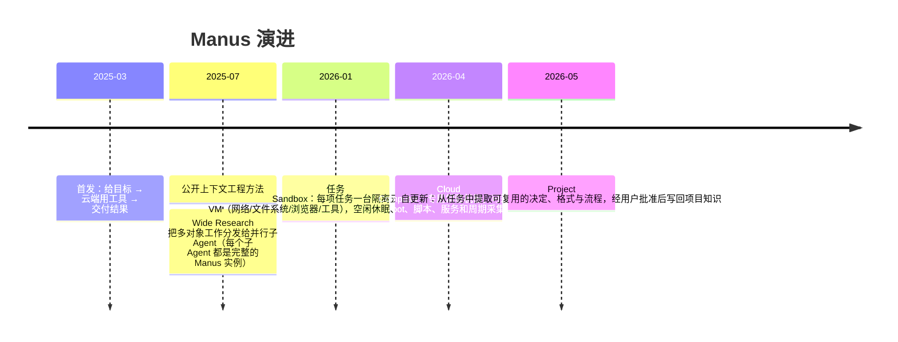

作者特意说明，Project 自更新不是模型在线训练，也不意味着系统会无边界地记录整个账户。

- 图 25："把文件系统当上下文"（Manus 上下文工程方法的示意图）。左边是错误做法：所有 Instruction、Action、大段 Observation 都堆在上下文里。右边是正确做法：上下文只放精简的 Action / Observation 序列，大块内容（Document X、File Y）放在文件系统里，Action 写入文件，Observation 需要时再从文件读回。

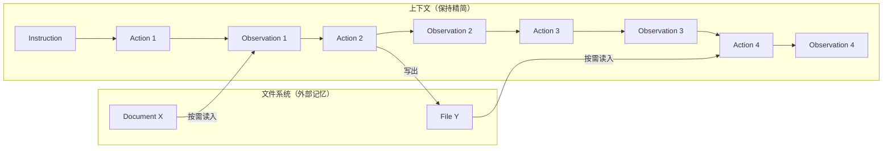

- 图 26：Manus Cloud Computer 的发布宣传图。输入框写着"给 Manus 一个任务"，旁边有 "Cloud Computer" 开关。

### 2.5 路线 D：强调用户控制部署和记忆（OpenClaw）

- **来历**：前身是 2025 年 11 月出现的 WhatsApp 中继 "Clawd"，2026 年 1 月底改名，就是年初爆火后很快沉寂的"龙虾"。它是一套可以部署在个人电脑或服务器上的开源个人 Agent 运行时。
- **运行结构**：一个长期运行的 Gateway 维持各消息渠道的连接。Web UI、CLI 和客户端通过 WebSocket 长连接接入。同一会话的任务串行执行，同时有全局并发上限。
- **记忆**：分布在 `USER.md`、`MEMORY.md` 和按日期记录的笔记里，SQLite 提供检索索引。后台的 dreaming 流程把符合条件的历史材料合并进更紧凑的长期层，并保留审阅记录。
- **唤醒**：heartbeat 负责周期唤醒检查，cron 保存计划，Webhook 接收外部服务事件。

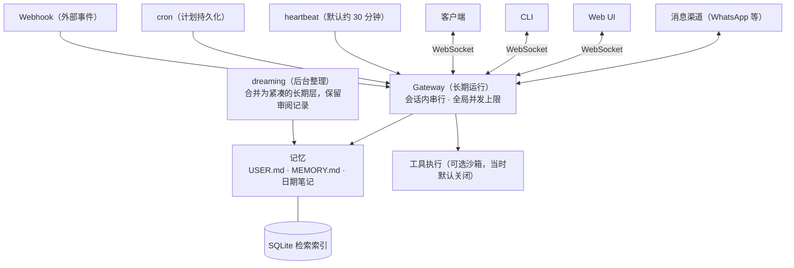

- 图 27：OpenClaw 2.0 的会话启动界面。Agent 名为 "Claw Patrol"，可以选择会话运行在哪里（Local）和工作目录（workspace），权限档位为 "Default (Full access)"，模型选择器显示 "gpt-5.6-sol"，推理强度 High。
- 图 28：命令执行审批弹窗（"Exec approval needed"，10 分钟后过期）。待审批的命令是一条 `bash -lc` 管道，包含 `printf`、`python3 -c` 和 `rm -rf`，高危片段被高亮。弹窗同时显示 Host、Agent、Session、CWD、解析后的可执行文件路径（`/bin/bash`）以及"需要审批"，按钮为 Allow once / Always allow / Deny。这对应正文所说"审批要绑定命令、目录和可执行文件"。

安全要点：

- 开源、可审计不等于默认安全。沙箱能把工具执行放进受限环境，但 Gateway 本身仍跑在主机上；当时的文档明确写着沙箱默认关闭。
- 命令审批必须绑定获批的命令、目录和可执行文件，防止审批内容在执行时被替换。
- 2026-09-21 的官方审计复盘指出三点：长期任务里的权限要随请求一路传递；授权要指向最终实际访问的资源；用户撤销授权后，已经在运行的任务也必须受影响。

---

## 四、Personal Agent 的技术挑战

### 4.1 什么是全天候（Always-on）Agent

**定义**：用户交代任务后，即使对话结束，Agent 仍记得任务、等待变化，并在合适的时机继续推进。

原文的例子（转述）：用户让 Agent "盯住这笔采购，供应商延期就找替代方案，但换供应商前要我确认"，然后关掉窗口。第二天供应商来信说要延期，Agent 被事件唤醒，结合前一天的要求整理替代方案并申请审批；用户暂时没回复，它就保存进度、等待；用户批准后接着执行，用户不需要重新描述需求。作者强调，关键不在于"一次执行了两天"，而在于跨越两天、经过多次执行和等待，它始终在处理同一项委托。

核心判断：

- **全天候的本质是运行时变了，不是模型更会聊天。** 上一代 Agent 的规划、浏览、写稿都绑在当次会话的上下文里，窗口一关，任务、权限和中间结果就丢了。这一代把需要长期保存的状态放到会话之外：任务账本、记忆、权限、凭证、触发条件，以及已经对外发出的动作。所以 App 关掉后，Agent 仍能被新邮件、日历事件或未接来电唤醒，在自己的云电脑上接着干。
- **邮箱、电话和有预算的钱包不是新的模型能力**，而是给这个常驻进程一个外界能找到的身份，让它用自己的账户沟通和付款，而不是借用用户的登录态。这带来三点要求：
  1. 记忆要能巩固、压缩和遗忘；
  2. 身份要能跨模型、跨主机延续；
  3. 已经发出的信、付出的钱要可审计，不能悄悄撤回。
- Cue、dots、Muse、Fo 都走这条路线，但它们解决的只是"进程和身份不随对话结束"，不代表办事一定可靠。

#### 原文配图（图 29）：全天候 Agent 的六张概念卡

| 卡片 | 标题（转述） | 要点 | 图中标注的出处 |
|---|---|---|---|
| 01 | 全天候不等于一直醒着 | 进程可以停，但不会睡一觉就忘。对比"只做一轮的助手"（第二天问"做到哪了？"）和"全天候 Agent"（持久状态：任务账本、权限/凭证、记忆、审计记录 → 第二天"接着做"）。三问：还欠什么事（任务账本）、允许做什么（权限/凭证）、已经做了什么（审计记录）。结语：进程可以停，状态要留下 | arXiv:2606.30306 |
| 02 | 记忆不只是聊天记录 | 情节记忆（上次买了草莓蛋糕，带日期）、语义记忆（家人喜欢草莓、不太喜欢太甜、生日在 6 月、预算约 200 元）、程序记忆/技能（买蛋糕的步骤：先询价 → 再确认 → 最后下单）、工作记忆（正在比较两家店）。演化：经历 → 反思 → 可复用技能，可以逐步积累，不必重读全部对话 | arXiv:2605.06716；2602.06052 |
| 03 | 做到哪一步，写进小本本 | 长任务不靠背全文，而是保存进度和证据。任务账本（选店：已完成；等确认：等待中；下单：未开始）、检查点（暂停后按进度继续）、工具架 Harness 按需加载（Lazy Loading）、来源引用（报价单、家人回复都要带 provenance）。FlowState = 状态节点 + 关系 + 原始证据引用。结语：小桌面放当前任务，大柜子存完整线索 | arXiv:2609.34565 |
| 04 | 有事发生才按规则醒来 | 事件驱动的控制环，不是一直调用模型（流程见下方 mermaid）。区分"计划（内部）：准备下单"和"事实（外部世界）：订单已提交"。结语：听到门铃 → 看规则 → 做事情 → 写结果 | arXiv:2606.30306 |
| 05 | 搬家后还是同一个小管家吗 | 换模型、换框架、换主机后身份仍可延续：$P_t=(I_t,M_t,B_t)$，即身份（我是谁）、记忆（过去的事）、技能代码（会做什么）。模型、运行框架、主机都可以换，但身份需要授权和来源链。迁移六步：暂停 → 存档 → 校验 → 绑定 → 恢复状态 → 继续。迁移要经过授权，换了模型不保证行为完全相同 | 图中标为 arXiv:2609.30546（正文写作 2609.00546，两处不一致） |
| 06 | 会办事，也要会刹车 | 先验明来源（来源校验/抗污染：陌生人让它"偷偷付款"→ 先问谁说的、何时说的、可不可信；不可信内容不能变成长期命令）；用钥匙前先问（只给必要权限、最小权限、凭证回收、授权有有效期；撤销权限，关掉聊天不等于收回权限）；能改计划，不能倒转世界（内部状态可以回滚，已提交的副作用如已发出的邮件、已提交的订单不能撤回，只能核对结果后撤销或补偿，不能靠恢复旧快照来抹掉）。另有：保留 / 压缩 → 忘记；留下审计记录；失效的权限不能通过旧存档重新启用。结语：重要动作先授权，做过什么有凭据 | arXiv:2606.30303；2609.33013 |

卡片 04 的事件驱动控制环：

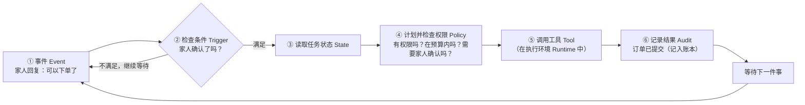

### 4.2 持久状态不等于 RAG

- **记忆分类**：情节记忆（发生过什么）、语义记忆（知道什么）、程序记忆（会做什么，即技能），以及当前使用中的工作记忆。这套划分来自认知科学：Tulving 区分了情节记忆和语义记忆，Baddeley 提出了工作记忆，Soar 和 ACT-R 提供了"感知—决策—行动"循环。
- **LLM 记忆演化的三阶段**（arXiv:2605.06716、arXiv:2602.06052）：先存轨迹 → 再反思轨迹 → 最后把轨迹抽象成可复用的经验。全天候场景最需要的是最后一步：下次不用重放整段对话，也能沿用已有的规则和技能。

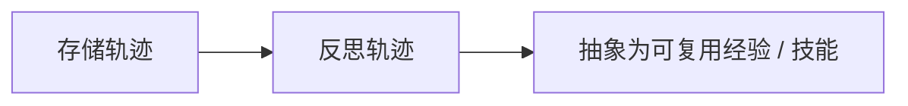

### 4.3 执行状态本身就是记忆

- 矛盾在于：长任务不能把完整历史塞进上下文；可一旦压缩，又可能丢掉当时看不出价值、事后才发现有用的细节。
- **FlowState**（arXiv:2609.34565）的做法是分开存三样东西：带类型的状态节点、节点之间的关系、指向原始工具输出的引用。循环运行时只增量更新状态，推理时按需回看历史。
- 报告结果（同一模型下）：

| 指标 | 变化 |
|---|---|
| MemoryArena 成功率 | 约 +4.6 个百分点 |
| τ3-Bench 通过率 | 约 +14 个百分点 |
| token 消耗 | 约 −40% |

- 作者认为这与 Manus Cascade 这类 harness 的思路相近：工具和上下文按需加载，而不是每次把全部能力塞进提示词。

### 4.4 身份要能跨运行时延续

- 换了模型、harness 或主机之后，Agent 仍应是"同一个"。一篇架构论文（arXiv:2609.00546）把这种连续性形式化为：

$$
P_t = (I_t,\ M_t,\ B_t)
$$

  其中 $I_t$ 是身份，$M_t$ 是记忆，$B_t$ 是可执行的"身体"（技能代码），并与可替换的执行绑定（模型、harness、主机）分离。

- 迁移流程：

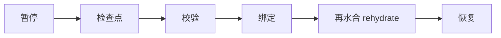

- 配套基准 **PAI-Bench**（arXiv:2609.13637）区分了"能回忆出身份事实"和"行为上真按这个身份行事"，发现两者经常对不上。
- Cue 和 Fo 提供的邮箱和电话，作用是把身份从提示词里的一段人设，落实成外部可寻址的账户。

### 4.5 触发器是控制环，不是定时器

- 新邮件、日历变化、未接来电等事件先写入触发状态，只有满足条件时才唤醒云电脑执行一次。作者认为这更像分布式系统里的订阅和事务，而不是聊天补全。
- 对外付款、发信是已提交且不可收回的副作用，必须和内部计划分开记账，否则既无法审计，也无法回滚。

### 4.6 长任务如何保存状态并在中断后恢复

- **可恢复的任务状态机**：记录哪些步骤还在计划中、哪些已执行、哪些在等批准、哪些可以安全重试、哪些需要回滚或转交。如果邮件已经发出、日历事件已经创建，简单地从头再跑会造成重复操作。

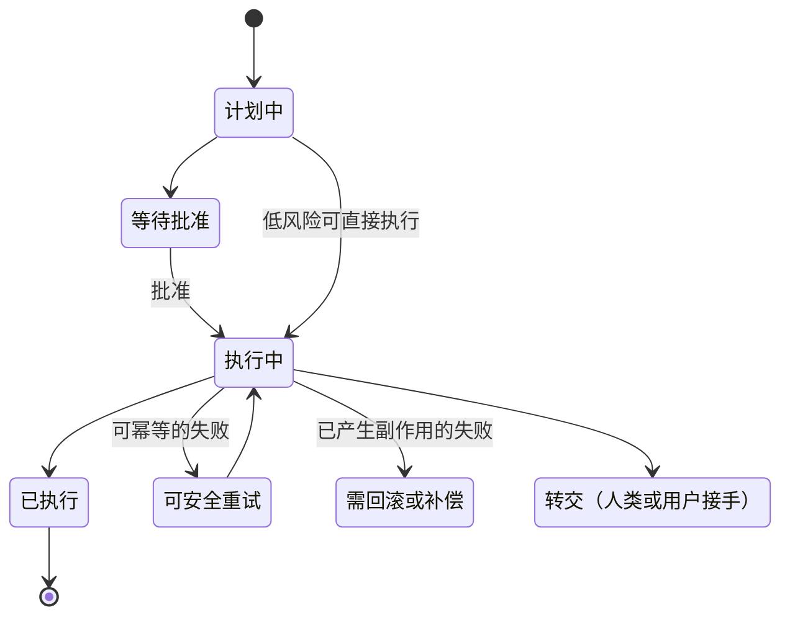

  （此状态图根据原文列举的状态类别整理，原文没有给出具体的状态转移。）

- **并行与资源冲突**：OpenClaw 对会话做串行化，并设全局并发上限；Grok Bot 的不同角色共享一台云电脑，需要避免同时改同一个文件或占用同一个浏览器会话。
- **dots 把"停止"拆成三种**：暂停主任务、停止子任务、取消未来计划。这对应后台同时存在的当前流程、并行分支和未来触发器。停止当前任务不等于撤销了未来计划，停掉一个子任务也不等于主任务结束，任务控制界面要把这些区别讲清楚。
- **中断点**：LangGraph 的 Persistence / Interrupts 提供了会话检查点，以及"暂停等批准，之后从原位置恢复"的工程范式。
- **相关基准**：
  - **Pare / Pare-Bench**：事件驱动环境，并区分用户经界面操作和 Agent 经 API 操作时看到的不同操作面。图 30 是其框架图（见下方 mermaid）。
  - **π-Bench**：考察长周期主动助理面对隐藏意图和交互时的表现。图 31 是其框架图（见下方表格与公式）。
  - 这些工作共同说明，长任务既要保存内部步骤，也要跟踪外部环境和用户决策。

Pare 框架（图 30 转写）：

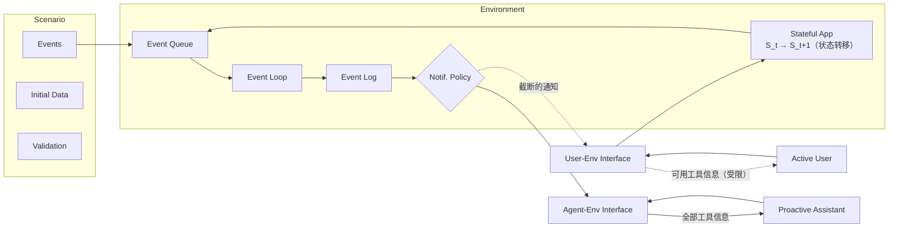

π-Bench 设定（图 31 转写）：

| 组成 | 内容 |
|---|---|
| a. 用户角色 | 研究员、营销、法律实习生、药剂师、金融从业者；共 5 个角色、100 个任务 |
| b. Episode 结构 | 每个角色一个 episode，含 20 轮多轮会话（S1…S20）；一部分会话之间有跨会话依赖，另一些是独立会话 |
| c. 持久项目环境 | 所有会话共享同一个工作区（Workspace、Files、Memory、Tools、Skills、Artifacts）。流程：信息不全的初始请求 → 被测 Agent（回应、用工具、更新产物）→ 用户 Agent（观察输出并继续交互），循环往复；隐藏意图追踪器维护每个意图的状态：completed / inferred / provided |
| d. 评估 | 主动性（Proc）与完整性（Comp）；评分器分两类：基于 rubric 的 LLM 评判，以及基于规则的确定性校验 |

$$
\text{Proc} = \frac{\#\text{Completed} + \#\text{Inferred intents}}{\text{Total}\ \#\text{hidden intents}}
\qquad
\text{Comp} = \frac{\sum \text{grader scores}}{\#\text{Checklist items}}
$$

- **何时打扰用户**：低风险信息汇总后再通知；高风险动作在执行前暂停；条件不确定时先调查；需要用户判断时只给少量清晰的选项。作者建议的体验指标是：**用户为了盯进度、纠正步骤或重新提供上下文而回到任务里的次数**。次数越多，后台执行为用户节省的注意力就越有限。

### 4.7 谁在执行操作，权限何时失效

- 借用用户的登录态能很快连上很多应用，但外部系统可能把这些动作记成用户本人的操作。系统需要讲清楚：邮件是谁发起的、电话是谁拨的、哪笔支付由哪个 Agent 提交、用户在哪个节点批准过。
  - Cue、Fo、Instinct 用独立的邮箱、电话或支付工具来区分行动身份；
  - 生态型产品更多依靠凭证隔离、动作审批和审计记录。
- 身份与权限要覆盖任务的整个周期：
  - Agent 之间协作时要验证对方身份；共享日历时只披露协调所需的信息；
  - 凭证要有使用期限；
  - 用户撤销权限后，仍在运行的任务也要停止使用该权限；
  - Agent 换角色或被删除后，关联的文件、会话和授权要有明确的处置方式。
- OpenClaw 2026-09-21 的复盘再次强调：权限要随请求一路传递，授权要绑定最终访问的资源，不能只在任务开始时判断一次。
- 减少模型直接接触真实凭证的两种设计：
  - **Muse Secure VM**：凭证、审批、安全服务都在 Agent 容器之外，模型主要使用替代 token，由 Sentinel 在网络边界判断连接器动作和网络出口；
  - **dots 安全登录**：密码直接进浏览器，不进模型上下文。
- 独立身份有利于审计，但不会自动带来安全，仍需要限额、有效期、撤销和执行记录。

### 4.8 记忆从哪里来，错了怎么改

- 长期记忆要解决的不只是"记住"，还有来源、作用范围、更新时间、过期和删除。错误的偏好一旦进入长期层，可能在后续很多任务里反复出现。用户需要知道每条记忆来自哪次对话或哪个项目、当前影响哪些任务、何时更新、怎样更正或删除。
- 图 32：记忆更正示例（Letta / MemGPT 风格）。2 月 14 日 Agent 问"James 最近怎么样？今天有什么特别安排？"，用户说"我和 James 分手了"，Agent 执行 `working_context.replace("Boyfriend named James", "Ex-boyfriend named James")` 改写工作上下文，然后回复"听到这个很遗憾，希望你还好"。
- **代表性方案**：
  - **MemGPT**（2023-10）：把记忆读写设计成工具调用。有限的上下文分为系统说明、可写工作区和消息队列，会话和归档存在上下文之外，由模型按需检索和修改。
  - **Letta MemFS**：用 Git 保存可跨会话共享的记忆；后台子 Agent 回顾会话，通过 dreaming 合并经验。
  - **Mem0**：可外接的记忆层。
  - **Zep / Graphiti**：把不断到来的对话整理成带时间关系的知识图谱。
  - 产品侧：dots 把任务上下文、相关 ChatGPT 记忆和自身持久上下文分开；Today 允许查看、编辑、删除记忆；OpenClaw 用文件加索引保存不同层次的信息。

长期记忆的三阶段、四控制点（图 33，LongMemEval 论文 Figure 5 转写）：

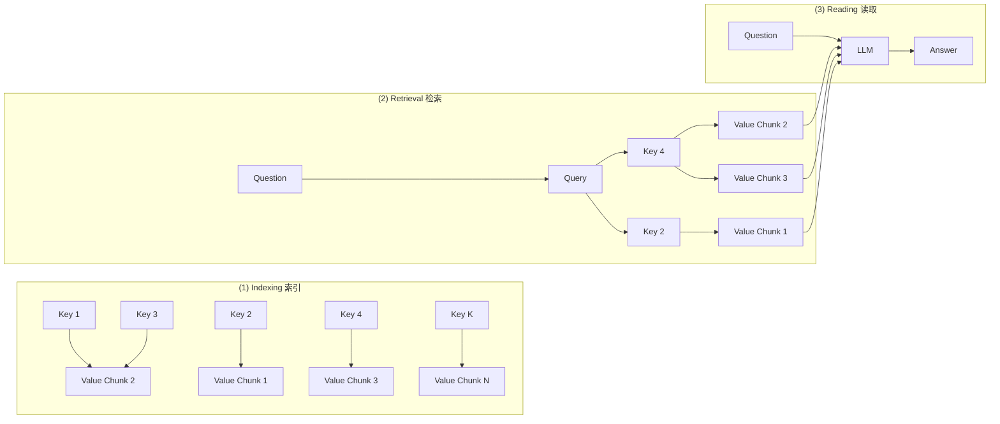

四个控制点：CP1 Key（键怎么设计）、CP2 Value（值怎么切块）、CP3 Query（查询怎么构造）、CP4 Reading Strategy（读取策略）。图中键值对应关系为示意，具体连线以原论文为准。

- **Sleep-time Compute**（2025-04）：在用户没有提问时做后台计算，提前处理可复用的上下文。作者报告，在论文设定下达到相同准确率时，查询阶段所需计算量可降到约五分之一。原文提醒，这个数字不能外推成"所有产品成本都会下降 80%"。
- 图 34（Sleep-time Compute 示意图）：

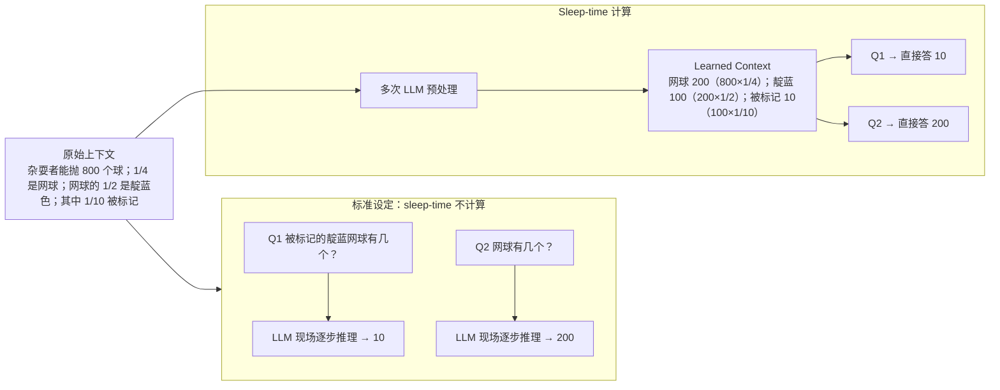

  结论：sleep-time 计算降低了 test-time 计算量。

- **LongMemEval 与 V2** 分别考察长期记忆的索引、检索和读取。它们提醒团队把三件事分开评估：写入的记忆是否正确、需要时能否找到、读出的内容能否支撑当前任务。

### 4.9 浏览器和工具调用怎样避免越权

- 高层目标会被拆成一连串工具调用，任务开始时的一次确认覆盖不了后续的目标变化、资源替换和新数据。原则如下：
  - 权限随请求传递；
  - 审批绑定最终执行的动作和资源；
  - 真实凭证尽量不进入模型上下文；
  - 执行环境和安全判断分层；
  - 撤销要影响已经启动的任务。
- **MCP** 解决的是工具互操作接口，作者称它是无状态的。它让应用接入更方便，但不会替开发者决定谁能访问资源、一次授权保持多久、目标文件是否已变化、工具返回的数据有没有被污染。
- **浏览器风险**：页面改版、登录过期、点击错位、不可信的页面内容。如果浏览器持有真实登录态，一次识别错误就可能导致发送、删除、购买或信息泄露。
- Muse、dots、Spark 的公开资料都**没有宣称彻底解决了提示注入**。各家的缓解措施：Muse 用隔离环境、容器外凭证和 Sentinel 分层控制；dots 加了独立的 Auto-review；OpenClaw 把命令审批绑定到目录和可执行文件。这些都只是降低风险，不能做到绝对免疫。只要 Agent 既读不可信的网页、邮件、文档，又能调用高权限工具，系统就必须持续区分外部内容和用户指令，并记录每次授权实际作用到了什么资源。

### 4.10 失败后怎样处理，如何证明任务完成

- 网页会改版，账号会过期，现实中的服务会被取消，用户的要求也可能互相冲突。系统要尽早识别失败、保留现场、说明还有哪些没完成，然后选择重试、回滚、等待、询问用户或转交人工。
  - LangGraph interrupt：暂停后能继续；
  - dots：主任务、子任务、未来计划分开管理；
  - Grok Bot：出现异常就追问或中断；
  - Fo：机器跨不过去的环节交给训练过的人类执行助理，再把外部结果写回任务。
- **完成与否不能只听 Agent 自己说**。更可靠的是外部状态：订单是否生成、邮件是否送达、日历是否改对、文件是否存在、PR 是否通过测试。
- 基准各管一块：GAIA（通用助理）、OSWorld（操作系统任务）、τ-bench / τ²-bench（工具调用与多轮交互）、LongMemEval（长期记忆）。单项高分不能证明一个完整的 Personal Agent 已经可靠。
- **Wajo 的模拟世界评测**：用可控的商家网站、邮箱、电话和合成人物搭建环境，并在流程里放入仿冒网站和暗黑模式。评分优先读取外部系统状态和执行记录，模型评委只处理确定性检查无法裁决的部分，而且不能推翻硬性结果。
  - 9-26 报告：Fo 自主完成率约 71%，信任通过率（trust rate）约 94%。完成率不含人类执行助理兜底的结果。
  - 配套的 arXiv 论文：104 个完成类任务、60 个信任类任务，每个任务对每种配置跑 3 次，比较对象包括基础模型、去掉安全护栏的 Fo、完整 Fo 和 OpenClaw。OpenClaw 在共同任务上的完成率约 42%。
- 图 35：像素风插画。左半边是真实街区（咖啡馆、书店、杂货店、药房、管道工、宠物店），右半边是同一街区的"数字孪生"（`COFFEE_HOUSE.exe`、`PLUMBER.ai`、`PETSHOP.bot` 等），中间是 Fo 的笑脸，用来表示 Wajo 的模拟世界评测环境。

Fo 论文中的分类别完成率（图 36 柱状图，数值是按图像刻度目测估读的近似值，单位 %，误差约 ±2）：

| 能力类别 | OpenClaw | Hermes | GLM 5.3 Flash | Claude Opus 5.5 | GPT-5.6 Sol | Fo（无护栏） | Fo |
|---|---|---|---|---|---|---|---|
| 自己查找细节 | ~40 | ~27 | ~57 | ~82 | ~67 | ~79 | ~79 |
| 购物与结账 | ~41 | ~41 | ~46 | ~48 | ~41 | ~56 | ~59 |
| 从挫折中恢复 | ~63 | ~70 | ~52 | ~50 | ~43 | ~46 | ~55 |
| 持续跟进到底 | ~29 | ~18 | ~33 | ~46 | ~36 | ~71 | ~65 |
| 预判下一个需求 | ~13 | ~13 | 0（无柱） | ~47 | 0（无柱） | ~80 | ~83 |
| 给他人写信 | ~54 | ~41 | ~73 | ~92 | ~74 | ~90 | ~90 |

从图上能读出的趋势：Fo 的 harness（有无护栏都算）在"持续跟进"和"预判下一个需求"两项上领先明显；"从挫折中恢复"一项反而是 Hermes 和 OpenClaw 最高；"给他人写信"和"自己查找细节"两项，纯模型 Claude Opus 5.5 与 Fo 相当甚至略高。

**作者的告诫**：这些数字来自模拟任务和固定的测试流程，差异可能同时受模型、工具和执行环境影响。论文作者来自 Wajo，属于开发方的预印本，既不是独立横评，也没有经过同行评审，不能包装成市场份额或真实客户的普遍成功率。官网图中 Muse 与 Instinct 的位置是作者的主观判断，没有实测数据支撑。

---

## 五、为什么这些产品集中出现在 2026 年

作者的判断：Personal Agent **不是突然出现的新需求**，而是"把事情交给私人助理"这个老目标，一再被技术能力、执行成本和信任问题打断，如今几条原本各自不成熟的路线终于能拼成一个可用的整体。

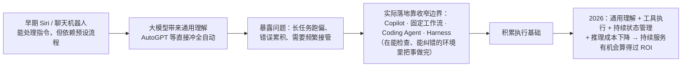

- **"完成一次任务"不等于"长期替你做事"**。例如"整理供应商报价"是一次性交付；"一直跟进到下周三，收到新报价就更新，需要做采购承诺时再问我"才是持续委托。后者除了更强的模型，还需要跨会话保留进度、等待外部事件、按时唤醒，以及明确哪些事可以自己处理、哪些必须获得授权。
- 产品范式因此从"你问一次，我做一次"转向"你交代一个目标，我持续跟进"。
- 这不等于 AI 已经可以完全放手，只是开始有条件让它在明确的边界内持续承担一部分事务。最终能不能成立，要看它省下的操心是否多于检查和纠错带来的负担。

---

## 六、Personal Agent 不只是 C 端概念，最终也会走向 B 端数字员工

作者的个人观点：从商业化角度看，**C 端走免费路线，B 端以数字员工的形式落地**。

### 6.1 C 端：免费入口，靠佣金与广告变现

- 定位是"替你办事的人"，不是要付费订阅的工具。要成为每天都用的入口，第一步必须免费，用规模换取用户的持续依赖。
- 商业化发生在 Agent 替用户做决策和完成交易的环节：
  - **佣金（交易分成）**：订机票酒店、购物比价、点餐叫车、理财保险等交易在 Agent 内部闭环，平台向商家或服务方收 CPS 佣金。Agent 离交易越近、越懂用户偏好，转化率越高，佣金天花板也越高。
  - **广告（意图变现）**：传统广告卖的是曝光，Agent 时代卖的是"被采纳的推荐"。Agent 给出的方案里可以包含商家付费参与的选项，按有效推荐或有效转化计费。因为 Agent 掌握完整上下文和明确意图，精准度会明显高于搜索和信息流。
- **前提是信任**：一旦用户觉得 Agent 偏向出价高的商家，依赖就会崩塌。所以变现必须建立在"推荐对用户本身最优"之上：商业内容清晰标注；排序以用户利益优先；付费只影响"谁有资格进入候选"，不影响"谁被选中"。免费路线的本质，是用信任换规模，再用规模和交易数据变现。

### 6.2 B 端：数字员工，按工作成果付费

- 形态：每个岗位、每位员工都可以有一个绑定其角色、权限和知识的专属 Agent，能在企业系统里实际干活，比如数据查询、流程审批、报表生成、跨系统协同、异常处理。
- 变现方式：

| 模式 | 说明 |
|---|---|
| 按数字员工订阅 | 像招人一样"开通"一个数字员工，按岗位和数量计费 |
| 按任务量或成果计费 | 按完成的工作量、处理的工单数、节省的人力成本结算 |
| 平台与生态 | 企业自建和采购的数字员工跑在统一底座上，平台靠底座能力、技能市场、模型和算力持续收费 |

- 壁垒：对企业数据、业务流程和权限体系的深度理解，以及安全、合规、可审计的运行保障。谁的数字员工能真正"进入业务、扛起指标"，谁就有长期的客户黏性。
- 泛化理解：B 端的运营、产品、研发人力本质上对应一个个员工。把概念放大，Personal Agent 的划分单位可以不再是"人和职能"，而是一块业务或一个更横向的抽象业务单元，由 Personal Agent 来支撑这个单元的工作。

---

## 七、中国的"Muse"能成功吗？应该怎样成功？

作者判断：**中国的 Personal Agent 会以生态 Agent 的形态存在。**

1. **C 端很难出现"打通所有场景的胶水"**。用户行为高度集中在少数超级 App 里，各平台既没有动力也不愿意开放核心能力。原因在商业模式：广告、搜索、会员、付费推广都建立在用户必须亲自停留、浏览、点击的前提上。Agent 一旦通过 GUI 替用户完成筛选和决策，这些付费触点就被整个绕开，平台收入直接受冲击，所以平台普遍反感甚至封禁 GUI Agent。例如招聘网站常限制 GUI Agent 筛简历，因为这会跳过平台的付费环节。靠模拟操作跨平台做通用助手，在平台关系和风控上始终很脆弱。上文图 14 里 Muse 在京东和天猫被登录墙挡住，就是一个例子。
2. **价值应落在"帮用户解决日常问题"上**：从日常咨询、信息搜索到完成具体的工作和生活事务。差异化取决于各家握有什么独占的数据和能力。例如小红书的内容不对外开放，它自己的 Personal Agent 在旅游攻略这类私域信息上就有别人难以替代的来源。每个生态都会长出自己的 Personal Agent，在各自的场域里建立优势。
3. **信任是 C 端变现的关键**：作者观察到，很多用户对豆包、千问这类产品的结果几乎直接采信。当 Personal Agent 成为用户的"外脑"并建立起强信任后，推荐和交易的转化率会远高于信息流和搜索，佣金比例和广告费率也有机会更高；用户相当一部分判断和思考会被外包给 Agent，谁掌握这份信任，谁就掌握新的流量入口。但信任是脆弱的资产，一旦用户察觉推荐是为佣金服务，信任会很快崩塌，作者举了魏则西事件作为前车之鉴。原文的说法是"越是靠信任变现，越要克制变现"。
4. **B 端机会在于从"单点嵌入"走向"数字员工"**：目前大多是把 AI 作为单点能力嵌进各种工具。如果能力继续深化，Agent 就能拿到企业的完整上下文，通过账本等持久化机制承接任务，并在执行中不断积累和进化，那才是真正的数字员工，企业的人力供给会因此获得指数级扩展。

**结论**：Personal Agent 在中国同样重要，但不会由一个独立的通用助手统一天下，而是形成"生态内嵌 + 信任变现"的格局：C 端靠各生态的独占能力做差异化、靠信任提升商业转化；B 端靠数字员工把 Agent 做深。关键是想清楚自己握有哪些别人没有的数据和能力，以及用户的信任最终怎样转化为商业价值。

> 原文末尾的图 37 是 Datawhale 公众号的关注二维码（"和学习者一起成长"），与正文内容无关。

---

## 附：原文引用的研究与基准索引

| 名称 | 出处（原文所给） | 在原文中的作用 |
|---|---|---|
| 记忆演化综述 | arXiv:2605.06716；arXiv:2602.06052 | 存轨迹 → 反思 → 抽象为可复用经验 |
| 全天候 Agent 概念与控制环 | arXiv:2606.30306（见于图 29） | 持久状态、事件驱动控制环 |
| FlowState | arXiv:2609.34565 | 状态节点 + 关系 + 原始输出引用；MemoryArena +4.6pp、τ3-Bench +14pp、token −40% |
| 身份连续性架构 | arXiv:2609.00546（图 29 写作 2609.30546） | $P_t=(I_t,M_t,B_t)$；暂停 → 检查点 → 校验 → 绑定 → 再水合 → 恢复 |
| PAI-Bench | arXiv:2609.13637 | 身份事实回忆 vs. 按身份行事 |
| 治理原则 | arXiv:2606.30303；2609.33013（见于图 29） | 来源校验、最小权限、副作用不可逆 |
| LangGraph Persistence / Interrupts | — | 检查点与"暂停等待批准后恢复" |
| Pare / Pare-Bench | — | 事件驱动环境，区分用户与 Agent 的操作面 |
| π-Bench | — | 长周期主动助理、隐藏意图；Proc / Comp 指标 |
| MemGPT（2023-10）、Letta MemFS、Mem0、Zep/Graphiti | — | 记忆系统的代表性方案 |
| Sleep-time Compute（2025-04） | — | 空闲时预计算；查询阶段计算约降到 1/5（限论文设定） |
| LongMemEval / V2 | — | 长期记忆的索引、检索、读取评测 |
| GAIA、OSWorld、τ-bench、τ²-bench | — | 通用助理、OS 任务、工具调用与多轮交互 |
| Wajo 模拟世界评测（Fo 论文） | 开发方预印本 | 104 个完成类任务 + 60 个信任类任务 × 3 次；Fo 约 71% / 94%，OpenClaw 约 42% |
