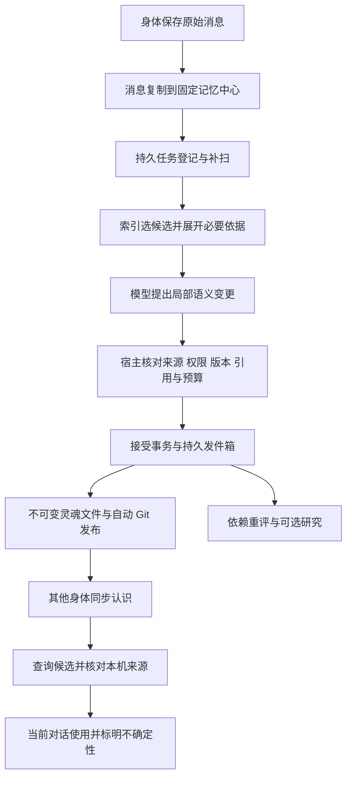

# 自适应记忆：当前设计与实现

这是当前分支的实现总览，连接[项目原则](../PRINCIPLES.md)、[行为契约](ADAPTIVE_MEMORY_CONTRACT.md)和源码。交付状态、测试结果与剩余工作统一见[试用版与 backlog](ADAPTIVE_MEMORY_RELEASE.md)；本文不把设计目标写成已通过的质量保证。

## 1. 目标与部署边界

系统从零散且可能有误的对话中形成可修正的认识，允许多个主题、身份候选、时间范围和推测。在相关对话中帮助回顾、关联与思考，不要求用户完整记录生活，也不预设领域本体。

多个身体保留各自对话入口和消息库，同一 agent 的可访问对话默认可关联。`adaptiveMemory.hostBody` 指定唯一记忆处理身体，与自动选举的心脏协调者无关。当前实现使用现有 Node runtime、SQLite 和私有灵魂 Git，不需要独立 Python 生产服务或图数据库。SQLite 承载关系图与索引；“没有独立图数据库”不等于没有关系结构或只能全量检索。

中心后台复用控制台配置的生成模型，自动准备固定的本机 E5 检索组件。其他身体通过认证 mesh 查询中心，再按自己可见的来源与已知修订核对材料。公共同步服务只承担其原有账户、信令和中转职责，不运行私人记忆推理。

## 2. 三个开关与旧记忆的关系

| 配置 | 当前行为 |
|---|---|
| `enabled=false`（默认） | 使用原有记忆路径。已经保存的自适应修订不会因为关闭开关就被当作从未发生 |
| `enabled=true, semantic=false` | 新路径接管对话事实写入，保留来源观察与原文读取；不进行语义整合 |
| `enabled=true, semantic=true` | 中心增量整理、依赖重评及混合检索；组件未就绪时可退回词面路径 |
| `research=true`（默认 false） | 在启用语义处理的中心增加有界后台研究；只在相关对话呈现，允许零条结果 |

控制台入口是“记忆 → 核心 → 对话记忆”。开关 `enabled` 决定事实写入归属：开启后，旧模型 `memory` 写入和 PRIME 自动学习暂停，不再并行生成另一份当前事实；旧 USER / MEMORY 等保留历史用途。人格、普通创作文档和管理者明确编辑不因此被禁用。关闭后恢复旧路径的后续工作，不撤销已知修订。

原有 PRIME 的个人确认和经验资格规则仍有独立用途，但不能套用为“新系统每条 reported 发言都已由用户确认属实”。两套机制的范围见[结构化记忆](STRUCTURED_MEMORY.md)与[语义协议](ADAPTIVE_MEMORY_SEMANTICS.md)。

## 3. 数据职责与可信程度

| 数据 | 当前表达与持久位置 | 不代表什么 |
|---|---|---|
| 原始来源 | SQLite 消息、角色、会话、身体、时间、hash、处理模式和本机 revision | 发言存在不等于说法真实；本机 revision 不是跨身体全局时钟 |
| 对象 Node | 名称、开放标签、语境、稳定 ID 与版本 | 同名不是同一身份，标签不是预设领域分类 |
| 提及 Mention | 精确原文锚点、多个候选、未知及版本化绑定 | 候选排名不是身份确认 |
| 认识 Claim | 正文、性质、参与者、显式指向、发生时间 / 有效范围、支持与反证 | `supported` 不是“现实已验证”，`conditional` 仍含未核实假设 |
| 依据 | 来源片段、认识 / 绑定的精确版本，AND 前提组、OR 支持组、反证与假设 | 共享来源、重复摘要、循环引用不会增加独立支持 |
| 工作与发布 | SQLite 持久任务、租约、重试、输入版本和发件箱 | 模型请求可能重做，任务 done 不等于远端已同步 |
| 权威语义存档 | 私有 `notes/QuetzalMemory/Adaptive/<job UUID>.md`，当前 result-v2 / semantic-v2 | 仅有灵魂 Git 不能恢复全部消息、待发布工作或外部文件 |
| 派生视图 | 可重建的 SQLite 图投影、倒排 / 来源 / 双向引用索引和向量缓存 | 缓存不是唯一认识副本，索引 ready 不是语义质量证明 |

灵魂目录格式仍是 [v14](../SOUL_REPO_SPEC.md)，旧 PRIME 的 `notes/QuetzalMemory/<id>_v<version>.md` 与新 Adaptive 存档分开。详细类型、引用约束和混合版本读取见[语义协议](ADAPTIVE_MEMORY_SEMANTICS.md)，发布事务与恢复见[存储协议](ADAPTIVE_MEMORY_STORAGE.md)。

## 4. 一条新发言如何进入系统

正常整合不把全部认识送入 LLM。`adaptive-lookup.ts` 用索引定位当前来源的已有认识、词项候选与会话 / 近期锚点，`adaptive-workset.ts` 按需读取候选、必要依赖和历史分支所指的当前版本。当前可选材料优先预算 128 KiB，必要上下文限 100 个来源、256 KiB 提示；这是宿主的工作预算，不是 Gemini 的上下文限制。必要闭包超限会保留失败或延后，不能截断证明后声称完成。

模型输出经规范化后仍由宿主拒绝过期版本、非法引用、越界语境和无效来源。接受、文件安装、本地 Git 确认、远端同步是不同阶段；不能假设 SQLite 和 Git 构成一个原子事务。重启由持久队列与发件箱恢复，不能承诺模型调用恰好一次。

来源或引用变化后，重评优先处理脏目标并用有界轮巡兜底。研究复用同一任务机制，最多三次检索规划加一次提案，保留前提和假设；助手旧答案不作为独立证据。当前版本计数与闭包机制能发现显式依赖过期，不能保证发现模型漏记的语义关系。

## 5. 读取、规模与异步一致性

前台语义查询融合词面、向量和有界同源候选扩展，最终至多六项，返回前核对当前版本和可见 / 全局共同有效依据。向量只建议候选，不能绕过身份、来源或权限校验。原文 FTS / recall 继续保留，避免派生图成为唯一入口。空结果和降级不是否定证据。

向量全局清单已改为持久分页目录、变更队列和公平扫描；生产全局 1000 条候选上限已移除。worker 按页扫描向量并保留 TopK，不物化全库 Map。单次工作集、闭包、文档分块、重建和结果仍有上限，且扫描成本会随规模增长；这不是任意规模性能保证。`current` 描述已知清单进度，`pending=0` 描述嵌入任务，二者都不证明远端数据已经齐全。

向量等待上限 100ms，宿主读取截止 500ms；同步冷 I/O 无法被该定时器抢占，所以不能当作严格端到端延迟 SLA。正常读取核查所用材料；首次使用、受控同步 / 撤回等会触发完整核查，自动后台 worker 另作全量巡检。绕过产品直接改库或改文件的未命中损坏可能延迟发现，这是已接受的运行边界。

语义 mesh 信封当前发送 v3，原文观察信封仍为 v1。接收身体不以中心的 ready 覆盖本机已知较新版本；缺原文、权限不符或版本冲突时降级。未收到的远端纠正无法立即获知，不提供全网线性一致性。

新回答与工具读取保存宿主生成的来源凭据。后续历史、摘要、recall 与 context_read 按已知修订投影，原始历史仍保留。模型返回后和最终保存前再次核查；正常对话遇已知变化可尝试一次只读答复恢复，不重放已执行写操作。已经流出的草稿无法收回；无凭据旧历史、外部文件 / Canvas 等未绑定材料，以及未发现的隐含依赖仍有覆盖缺口。

## 6. 两段合成轨迹

**“小黑”与录音计划。** 用户一月分别提过黑色录音笔与硬盘，二月说“小黑坏了”。Mention 可保留两个候选；若模型暂时误绑录音笔，后续“录音计划可能受影响”应带这一依赖，而不能成为独立观测。用户随后说“是硬盘的线坏了，录音笔没问题”：保存新来源，修订对象绑定及损坏命题，保留与纠正无关的原信息，依赖旧版本的推测失去现行支持并等待重评。另一身体三月讨论录音计划时，只有同步且核对到的新材料才可用于答复。“二月没问题”仍不自动保证三月设备一定正常。

如果另有适用材料明确说录音笔刚因另一故障送修，系统应指出日期 / 故障对象的具体不协调，询问是否已经修好；旧回答说过“录音笔坏了”本身不构成这种独立冲突。这描述期望协作过程，实际消歧与纠正覆盖需轨迹评测，不能由例子声称必然成功。

**排练改期与小说素材。** “以前周四合唱，现在改周二”是有效期变化；“上月说周四是我记错了”是历史修正，两者需要不同时间理解。后来“周四港口夜班很适合写父亲那一章，回程还有末班车”同时涉及行程、创作和故事角色。系统可以建议把夜班与旧录音作为素材组合，不能说用户过去就是受这些素材启发，更不能把小说父亲与现实亲属合并。若只知道末班车约十点、活动结束时间未知，应提出待核对的交通约束，不能制造确定冲突或保证赶得上。

## 7. 实现入口与当前缺口

以下路径相对 `runtime/src/`，详细文件地图见[runtime 架构](../../runtime/docs/ARCHITECTURE.md)。

| 责任 | 入口 |
|---|---|
| 启停、中心判断、状态和调度 | `memory/adaptive.ts`、`ops.ts`、`config.ts` |
| 来源与持久任务、局部整合 | `memory/adaptive-store.ts`、`adaptive-worker.ts`、`adaptive-model.ts`、`adaptive-proposal.ts` |
| 认识与证据、接受和发布 | `memory/adaptive-graph.ts`、`adaptive-evidence.ts`、`adaptive-archive.ts`、`adaptive-publication.ts` |
| 工作集、检索、组件和分页向量 | `memory/adaptive-lookup.ts`、`adaptive-workset.ts`、`adaptive-query.ts`、`adaptive-component.ts`、`adaptive-vector*.ts` |
| 重评、研究、完整性巡检 | `memory/adaptive-review*.ts`、`adaptive-research.ts`、`adaptive-integrity.ts`、`adaptive-audit*.ts` |
| 多身体与读取凭据 | `mesh/adaptive-memory.ts`、`memory/adaptive-query-packet.ts`、`adaptive-reading.ts`、`answer-basis.ts`、`read-receipt.ts`、`mind/context.ts` |
| 备份与新身体恢复 | `memory/backup.ts`、`backup-files.ts`、`restore.ts`；管理入口与 CLI 分别负责在线备份和离线恢复 |

当前已交付完整入口的试用版本，M0–M4 的原型与本机证据保留。全量语义质量、时间范围泛化、大历史查询可用性、研究净收益、完整跨平台冷安装与真人体验仍有缺口。没有“越用越正确”的证明；不以局部工程回归或代理模拟替代这些结果。具体成绩、失败分母和下一步优先级只维护在[交付说明](ADAPTIVE_MEMORY_RELEASE.md)与[评测登记](ADAPTIVE_MEMORY_EVAL.md)，不在多个总览重复计分。
